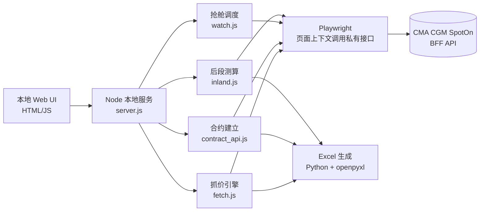

# CMA SpotOn Suite

> 基于 CMA CGM SpotOn 报价，实现的效率提升套件：批量抓价、报价单生成、满舱监控抢舱、内陆费用测算。
> An efficiency suite built on CMA CGM SpotOn quoting: batch rate scraping, quotation generation, sold-out sailing monitoring with auto-grab, and inland cost calculation.


---

## 中文

### 功能

| 模块 | 说明 |
|---|---|
| 批量抓价 | 一次抓取三个区域的实时运价与舱位，生成 Excel 报价表 |
| 合约建立 | 按指定船期生成 SpotOn 正式报价单 |
| 自动抢舱 | 监控已满舱的低价船期，放舱即自动建单 |
| 内陆后段测算 | 按 POD 到 FPOD 计算内陆段费用 |
| 免柜期查询 | 按港口查询免柜期天数 |

详细操作说明见 [docs/USAGE_zh.md](docs/USAGE_zh.md)。

### 架构



浏览器负责登录态与同源上下文，接口调用在页面内完成，Excel 由 Python 生成。

### 快速开始

环境要求：Windows、Node.js 18 以上、Python 3.10 以上、Chrome 或 Edge

```powershell
pnpm install
pip install openpyxl
# 双击 报价助手.vbs 启动，首次使用需登录 CMA 账号
```

把 `settings.example.json` 复制为 `settings.json` 后按需修改。

不想装环境？到 [Releases](https://github.com/Akash1QWQ/cma-spoton-suite/releases) 下载便携版压缩包，解压后双击 `报价助手.vbs` 即可运行，无需安装 Node 与 Python。

### 核心实现

1. 私有接口直接请求返回 403，改为在已登录页面内调用，携带同源 Cookie 与 CSRF；
2. 部分接口需先选定航次，再用返回的 OfferId 走后续流程；
3. 会话空闲 25 到 30 分钟过期，内置保活与掉线恢复；
4. 后段费用并入海运费，采用同船前后段总价相减，统一排除超重费、进口费与人民币费用；
5. 按港口与线路缓存原始报价，支持断点续跑。

### 效果对比

| 环节 | 手工 | 本工具 |
|---|---|---|
| 单区域全量取价 | 约 2 小时 | 2 到 4 分钟 |
| 生成报价表 | 约 30 分钟 | 自动 |
| 生成 SpotOn 报价单 | 约 15 分钟 | 约 10 秒 |
| 抢已满舱船期 | 手工刷新 | 定时轮询 |

### 目录结构

```
报价助手.vbs                 启动器
app/                         程序与数据
  server.js                  本地服务
  ui.html                    界面
  fetch.js                   抓价
  contract_api.js            合约建立
  inland.js                  后段测算
  watch.js / watch_check.js  抢舱
  *.py                       Excel 生成
  ports.csv                  港口表
  inland_lanes.csv           内陆线路表
docs/USAGE_zh.md             中文使用说明
```

### 已知限制

- 仅支持 Windows；
- 依赖使用者自己的 CMA 账号；
- SpotOn 为私有接口，可能随官方调整变化；
- 抢舱为实验性功能，高频轮询可能触发风控；
- 仓库不含真实运价数据。

### 授权与免责

本项目采用 PolyForm Noncommercial License 1.0.0，个人学习、研究与非营利使用免费，任何商业用途需另行取得书面授权，联系方式 akashiqwq@foxmail.com。全文见 [LICENSE](LICENSE)。

本项目为个人开发的效率工具，与 CMA CGM 官方无关。使用者需自行确保拥有合法账号与访问权限，并遵守 CMA CGM 的服务条款，运价数据版权归 CMA CGM 所有。

---

## English

### Features

| Module | Description |
|---|---|
| Batch rate scraping | Scrape live rates and space for three regions in one run and export Excel quote sheets |
| Quotation generation | Create an official SpotOn quotation for a chosen sailing |
| Sold-out auto-grab | Watch full but low-priced sailings and book automatically when space is released |
| Inland leg costing | Calculate inland cost from POD to FPOD |
| Detention and demurrage lookup | Query free-time days by port |

### Architecture

The browser provides the authenticated same-origin context, API calls run in-page, and Excel files are generated by Python.

### Getting Started

Requires Windows, Node.js 18 or later, Python 3.10 or later, and Chrome or Edge.

```powershell
pnpm install
pip install openpyxl
# double-click 报价助手.vbs, then log in to CMA once
```

Copy `settings.example.json` to `settings.json` and adjust as needed.

Prefer no setup? Download the portable package from [Releases](https://github.com/Akash1QWQ/cma-spoton-suite/releases), unzip it and double-click `报价助手.vbs` — no Node.js or Python installation required.

### Implementation Notes

1. Private endpoints reject direct requests, so they are invoked inside an authenticated page with same-origin cookies and CSRF token.
2. Some endpoints require selecting a sailing first, then using the returned OfferId downstream.
3. Sessions expire after 25 to 30 minutes idle, with keep-alive and automatic recovery.
4. Inland cost is folded into ocean freight, so it is derived by subtracting same-vessel totals and excluding overweight surcharges, import charges and CNY fees.
5. Responses are cached per port and lane to support resume.

### Benchmark

| Step | Manual | This tool |
|---|---|---|
| Full crawl per region | about 2 hours | 2 to 4 minutes |
| Quote sheet | about 30 minutes | automatic |
| SpotOn quotation | about 15 minutes | about 10 seconds |
| Catching a released sailing | manual refresh | scheduled polling |

### Project Structure

```
报价助手.vbs                 launcher
app/                         application and data
  server.js                  local service
  ui.html                    user interface
  fetch.js                   rate scraping
  contract_api.js            quotation generation
  inland.js                  inland cost
  watch.js / watch_check.js  auto-grab
  *.py                       Excel generation
  ports.csv                  port table
  inland_lanes.csv           inland lane table
docs/USAGE_zh.md             Chinese usage guide
```

### Limitations

- Windows only;
- Requires the user's own CMA account;
- SpotOn endpoints are private and may change;
- Auto-grab is experimental and frequent polling may trigger rate limiting;
- No real freight data is included.

### License and Disclaimer

Licensed under the PolyForm Noncommercial License 1.0.0: free for personal, educational and research use, while any commercial use requires a separate written license. Contact akashiqwq@foxmail.com. See [LICENSE](LICENSE).

This is an independent tool and is not affiliated with CMA CGM. Users must hold a valid account and comply with CMA CGM's terms of service. Freight data remains the property of CMA CGM.
