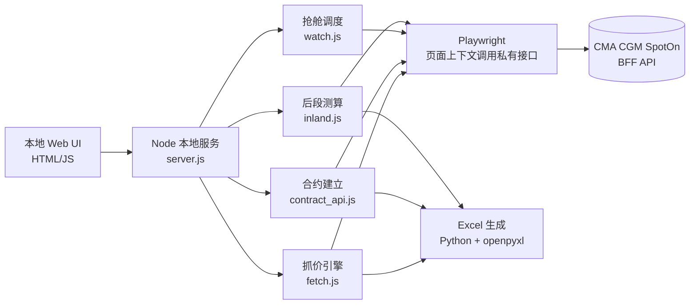

# CMA SpotOn Suite

> 基于 CMA CGM SpotOn 报价，实现的效率提升套件：批量抓价、报价单生成、满舱监控抢舱、内陆费用测算。
> An efficiency suite built on CMA CGM SpotOn quoting: batch rate scraping, quotation generation, sold-out sailing monitoring with auto-grab, and inland cost calculation.

---

## 中文

### 一、功能

| 模块 | 说明 |
|---|---|
| **批量抓价** | 覆盖 160 个目的港（非洲 59 / 中南美 63 / 地中海黑海 38），一次抓取实时运价与舱位，自动生成 Excel（价格汇总 + 航次明细 + 跨月价格变动图表） |
| **合约建立** | 按指定船期一键生成 SpotOn 正式报价单（QSPOT 号），约 10 秒；支持组合柜型（如 1×20GP + 1×40HQ），满舱自动跳过 |
| **自动抢舱** | 监控已满舱的便宜船期，按设定间隔轮询，放舱瞬间自动建单并通知（界面横幅 + 记录 + 桌面弹窗） |
| **内陆后段测算** | 按 POD → FPOD 计算内陆段费用：同船同航次总价相减，支持重量分档，排除超重费 / 进口费 / 人民币费用 |
| **免柜期查询** | 本地数据包按港口查询免柜期天数，可查看原始 PDF |

详细操作说明见 [docs/USAGE_zh.md](docs/USAGE_zh.md)。

### 二、架构



核心思路：浏览器只负责提供登录态与同源上下文，接口调用在页面内 `fetch` 完成；Excel 生成交给 Python（openpyxl），排版与图表更可控。

### 三、快速开始

**环境要求**：Windows 10/11、Node.js ≥ 18、Python ≥ 3.10、Chrome 或 Edge

```powershell
# 1) 安装依赖
pnpm install
pip install openpyxl

# 2) 启动（会打开一个无地址栏的 Chrome 应用窗口）
#    双击 报价助手.vbs

# 3) 首次使用需在弹出的窗口里登录 CMA 账号
```

配置：把 `settings.example.json` 复制为 `settings.json`，按需修改起运港、开船日偏移、单柜最大净重。

### 四、核心实现要点

1. **私有 API 访问**：直接请求返回 403，改为在已登录页面内 `page.evaluate(fetch)`，携带同源 Cookie 与 CSRF；
2. **SPA 状态依赖**：部分接口需先 `PATCH updatenextdeparture` 选定航次，再用返回的 OfferId 走后续流程；
3. **会话保持**：CMA 会话空闲 25~30 分钟过期，内置保活与掉线暂停 / 自动恢复；
4. **口径一致**：后段费用无独立科目（并入海运费），采用「同船前后段总价相减」，并统一排除超重费、进口费、人民币费用；
5. **缓存与续跑**：按港口 / 线路缓存原始报价，支持断点续跑与重算，不重复消耗请求。

### 五、效果对比

| 环节 | 手工 | 本工具 |
|---|---|---|
| 单区域全量取价（59~63 港） | ≈ 2 小时 | 2~4 分钟 |
| 生成一份报价表 | ≈ 30 分钟 | 自动生成 |
| 生成一单 SpotOn 报价 | ≈ 15 分钟 | ≈ 10 秒 |
| 抢已满舱的便宜船期 | 只能手工反复刷 | 定时轮询 + 放舱即建单 |

### 六、目录结构

```
server.js                    本地服务（HTTP API + 任务调度）
ui.html                      界面（单文件，原生 HTML/CSS/JS）
fetch.js                     抓价引擎
contract_api.js              合约建立
inland.js                    内陆后段测算
watch.js / watch_check.js    抢舱调度与单次检查
to_xlsx.py                   报价表生成
to_inland_xlsx.py            后段表生成
contract_xlsx.py             合约记录生成
watch_xlsx.py                抢舱记录生成
month_chart.py               价格变动图表
lib.js / login.js            浏览器启动与会话、登录
ports.csv                    港口表（160 行）
inland_lanes.csv             内陆线路表（50 行）
dd/                          免柜期数据包（索引随仓库，PDF 需自行准备）
docs/USAGE_zh.md             中文使用说明
```

### 七、已知限制

- 仅支持 Windows（启动器为 `.bat` / `.vbs`）；
- 依赖**使用者自己的** CMA 账号，账号权限决定可用范围；
- SpotOn 为私有接口，CMA 调整后可能需要同步修改；
- 抢舱为实验性功能，高频轮询可能触发风控，请自行控制频率；
- 仓库不含任何真实运价数据，截图中的金额均为示意。

### 八、授权与免责

本项目采用 **PolyForm Noncommercial License 1.0.0**：个人学习、研究、非营利使用免费；**任何商业用途需另行取得书面授权**（akashiqwq@foxmail.com）。全文见 [LICENSE](LICENSE)。

> 本项目为个人开发的效率工具，与 CMA CGM 官方无关，未获其授权或背书。
> 使用者需自行确保拥有合法账号与访问权限，并遵守 CMA CGM 的服务条款；运价数据版权归 CMA CGM 所有，本项目不分发任何抓取数据。

---

## English

### Features

- **Batch rate scraping** — 160 destinations (Africa 59 / LatAm 63 / Med & Black Sea 38) in one run, with Excel output: price summary, sailing details and month-over-month price charts.
- **Quotation generation** — create an official SpotOn quotation (QSPOT) for a chosen sailing in ~10 seconds; supports combined equipment (e.g. 1×20GP + 1×40HQ) and skips sold-out sailings automatically.
- **Sold-out auto-grab** — watch full-but-cheap sailings, poll at a configurable interval and book the moment space is released (UI banner + record + desktop notification).
- **Inland leg costing** — POD → FPOD inland cost by subtracting same-vessel/same-voyage totals, with weight tiers and consistent exclusions (overweight surcharge, import charges, CNY fees).
- **Detention & demurrage lookup** — offline data pack with per-port free-time days and original PDFs.

### Architecture

The browser only provides an authenticated, same-origin context; all API calls run in-page via `fetch`. Excel generation is delegated to Python + openpyxl for full control over layout and charts.

### Getting Started

Requires Windows 10/11, Node.js ≥ 18, Python ≥ 3.10 and Chrome or Edge.

```powershell
pnpm install
pip install openpyxl
# double-click 报价助手.vbs, then log in to CMA once
```

Copy `settings.example.json` to `settings.json` and adjust the origin port, ETD offset and max net weight.

### Implementation Notes

1. Private BFF endpoints return 403 to direct requests — they are invoked in-page with same-origin cookies and CSRF token.
2. The SPA requires `PATCH updatenextdeparture` to select a sailing before the returned OfferId can be used downstream.
3. Sessions expire after 25–30 minutes idle; the app keeps them alive and pauses/resumes on expiry.
4. Inland cost has no dedicated charge line (it is folded into ocean freight), so it is derived by subtracting same-vessel totals with consistent exclusions.
5. Responses are cached per port/lane to support resume and re-computation without extra requests.

### Benchmark

| Step | Manual | This tool |
|---|---|---|
| Full rate crawl (59–63 ports) | ~2 hours | 2–4 minutes |
| One quote sheet | ~30 minutes | automatic |
| One SpotOn quotation | ~15 minutes | ~10 seconds |
| Catching a released sailing | manual refreshing | scheduled polling + auto-book |

### Limitations

- Windows only (launchers are `.bat` / `.vbs`);
- Requires the user's own CMA account and permissions;
- SpotOn endpoints are private and may change without notice;
- Auto-grab is experimental — high polling frequency may trigger rate limiting;
- No real freight data is included in this repository.

### License & Disclaimer

Licensed under the **PolyForm Noncommercial License 1.0.0** — free for personal, educational and research use. **Any commercial use requires a separate written license** (akashiqwq@foxmail.com). See [LICENSE](LICENSE).

> This is an independent tool and is not affiliated with, endorsed by, or sponsored by CMA CGM. Users must ensure they hold a valid account and comply with CMA CGM's terms of service. Freight data remains the property of CMA CGM; this repository distributes no scraped data.
