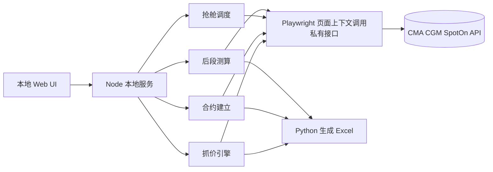

# CMA SpotOn Suite

> 基于 CMA CGM SpotOn 报价，实现的效率提升套件：批量抓价、报价单生成、满舱监控抢舱、内陆费用测算。
> An efficiency suite built on CMA CGM SpotOn quoting: batch rate scraping, quotation generation, sold-out sailing monitoring with auto-grab, and inland cost calculation.

---

## 中文

### 一、功能

| 模块 | 说明 |
|---|---|
| **批量抓价** | 覆盖非洲、中南美、地中海黑海三个区域共 160 个目的港，一次抓取实时运价与舱位，生成价格汇总、航次明细与价格变动图表 |
| **合约建立** | 按指定船期生成 SpotOn 正式报价单，约 10 秒，支持组合柜型，满舱自动跳过 |
| **自动抢舱** | 监控已满舱的便宜船期，按设定间隔轮询，放舱瞬间自动建单并通知 |
| **内陆后段测算** | 按 POD → FPOD 计算内陆段费用，同船同航次总价相减，支持重量分档 |
| **免柜期查询** | 本地数据包按港口查询免柜期天数，可查看原始 PDF |

详细操作说明见 [docs/USAGE_zh.md](docs/USAGE_zh.md)。

### 二、架构



浏览器只负责提供登录态与同源上下文，接口调用在页面内 `fetch` 完成；Excel 生成交给 Python，排版与图表更可控。

### 三、快速开始

环境要求：Windows 10/11、Node.js ≥ 18、Python ≥ 3.10、Chrome 或 Edge

```powershell
pnpm install
pip install openpyxl
# 双击 报价助手.vbs 启动，首次使用需登录 CMA 账号
```

把 `settings.example.json` 复制为 `settings.json`，按需修改起运港、开船日偏移、单柜最大净重。

### 四、核心实现要点

1. **私有 API 访问**：直接请求返回 403，改为在已登录页面内 `page.evaluate(fetch)`，携带同源 Cookie 与 CSRF；
2. **SPA 状态依赖**：部分接口需先 `PATCH updatenextdeparture` 选定航次，再用返回的 OfferId 走后续流程；
3. **会话保持**：CMA 会话空闲 25~30 分钟过期，内置保活与掉线暂停、自动恢复；
4. **口径一致**：后段费用无独立科目，并入海运费，因此采用同船前后段总价相减，并统一排除超重费、进口费、人民币费用；
5. **缓存与续跑**：按港口与线路缓存原始报价，支持断点续跑与重算，不重复消耗请求。

### 五、效果对比

| 环节 | 手工 | 本工具 |
|---|---|---|
| 单区域全量取价 | ≈ 2 小时 | 2~4 分钟 |
| 生成一份报价表 | ≈ 30 分钟 | 自动生成 |
| 生成一单 SpotOn 报价 | ≈ 15 分钟 | ≈ 10 秒 |
| 抢已满舱的便宜船期 | 手工反复刷新 | 定时轮询，放舱即建单 |

### 六、目录结构

```
server.js                    本地服务与任务调度
ui.html                      界面
fetch.js                     抓价引擎
contract_api.js              合约建立
inland.js                    内陆后段测算
watch.js / watch_check.js    抢舱调度与单次检查
to_xlsx.py                   报价表生成
to_inland_xlsx.py            后段表生成
contract_xlsx.py             合约记录生成
watch_xlsx.py                抢舱记录生成
month_chart.py               价格变动图表
lib.js / login.js            浏览器启动与会话
ports.csv                    港口表
inland_lanes.csv             内陆线路表
dd/                          免柜期数据包
docs/USAGE_zh.md             中文使用说明
```

### 七、已知限制

- 仅支持 Windows；
- 依赖使用者自己的 CMA 账号，账号权限决定可用范围；
- SpotOn 为私有接口，CMA 调整后可能需要同步修改；
- 抢舱为实验性功能，高频轮询可能触发风控，请自行控制频率；
- 仓库不含任何真实运价数据。

### 八、授权与免责

本项目采用 PolyForm Noncommercial License 1.0.0：个人学习、研究、非营利使用免费；任何商业用途需另行取得书面授权，联系方式 akashiqwq@foxmail.com。全文见 [LICENSE](LICENSE)。

本项目为个人开发的效率工具，与 CMA CGM 官方无关，未获其授权或背书。使用者需自行确保拥有合法账号与访问权限，并遵守 CMA CGM 的服务条款；运价数据版权归 CMA CGM 所有，本项目不分发任何抓取数据。

---

## English

### Features

- **Batch rate scraping** — 160 destinations across Africa, Latin America and Mediterranean / Black Sea in one run, producing price summaries, sailing details and price-change charts.
- **Quotation generation** — create an official SpotOn quotation for a chosen sailing in about 10 seconds, with combined equipment support and automatic skipping of sold-out sailings.
- **Sold-out auto-grab** — watch full-but-cheap sailings, poll at a configurable interval and book the moment space is released.
- **Inland leg costing** — POD → FPOD inland cost derived from same-vessel, same-voyage totals, with weight tiers.
- **Detention and demurrage lookup** — offline data pack with per-port free-time days and original PDFs.

### Architecture

The browser only provides an authenticated, same-origin context; API calls run in-page via `fetch`. Excel generation is delegated to Python for full control over layout and charts.

### Getting Started

Requires Windows 10/11, Node.js ≥ 18, Python ≥ 3.10 and Chrome or Edge.

```powershell
pnpm install
pip install openpyxl
# double-click 报价助手.vbs, then log in to CMA once
```

Copy `settings.example.json` to `settings.json` and adjust the origin port, ETD offset and maximum net weight.

### Implementation Notes

1. Private BFF endpoints return 403 to direct requests, so they are invoked in-page with same-origin cookies and CSRF token.
2. The SPA requires `PATCH updatenextdeparture` to select a sailing before the returned OfferId can be used downstream.
3. Sessions expire after 25 to 30 minutes idle; the app keeps them alive and pauses or resumes on expiry.
4. Inland cost has no dedicated charge line and is folded into ocean freight, so it is derived by subtracting same-vessel totals with consistent exclusions.
5. Responses are cached per port and lane to support resume and recomputation without extra requests.

### Benchmark

| Step | Manual | This tool |
|---|---|---|
| Full rate crawl per region | about 2 hours | 2 to 4 minutes |
| One quote sheet | about 30 minutes | automatic |
| One SpotOn quotation | about 15 minutes | about 10 seconds |
| Catching a released sailing | manual refreshing | scheduled polling and auto-booking |

### Limitations

- Windows only;
- Requires the user's own CMA account and permissions;
- SpotOn endpoints are private and may change without notice;
- Auto-grab is experimental and high polling frequency may trigger rate limiting;
- No real freight data is included in this repository.

### License and Disclaimer

Licensed under the PolyForm Noncommercial License 1.0.0: free for personal, educational and research use, while any commercial use requires a separate written license. Contact akashiqwq@foxmail.com. See [LICENSE](LICENSE).

This is an independent tool and is not affiliated with, endorsed by, or sponsored by CMA CGM. Users must ensure they hold a valid account and comply with CMA CGM's terms of service. Freight data remains the property of CMA CGM, and this repository distributes no scraped data.
